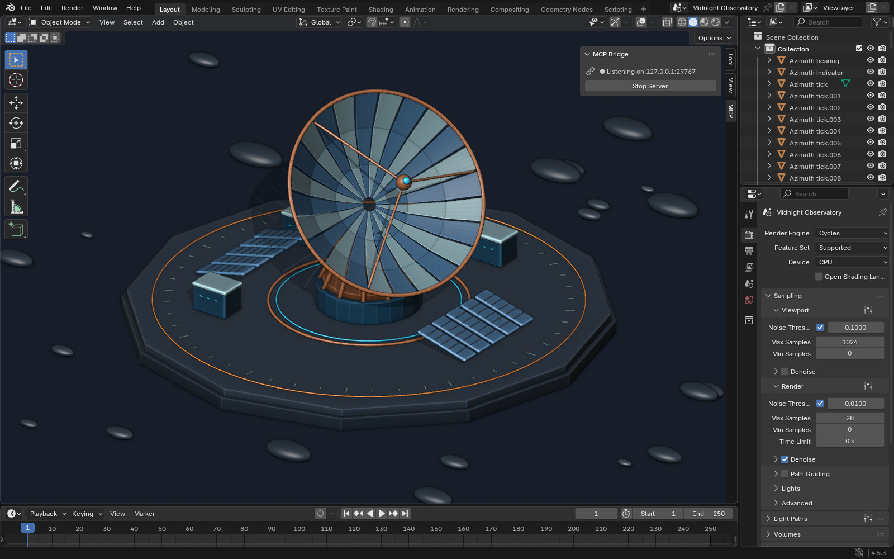

# Blender MCP Server

Give an MCP client access to Blender. Inspect the open scene, build and edit objects and materials, animate, render, export, and save a project through typed tools. The server runs over stdio and connects to an authenticated add-on in Blender.


[Reproduce the Midnight Observatory scene](examples/demos/04_midnight_observatory.py) · [More demos](docs/demos/README.md)

## Get started

Install Python 3.10+ and Blender 3.6+. Clone the repository and run the commands from its root.

On macOS or Linux, run setup and start your client.

```sh
./scripts/setup.sh
./scripts/start.sh codex
```

Use `claude` for Claude Code or `none` to launch Blender by itself. Run `./scripts/stop.sh` to stop the launched Blender instance.

On Windows, run setup, start, and status from PowerShell.

```powershell
.\scripts\windows.ps1 Setup
.\scripts\windows.ps1 Start
.\scripts\windows.ps1 Status
```

`Status` makes an authenticated `scene.get_info` call. Setup also writes `.venv/blender-mcp.json` for your client. See the [Windows client instructions](docs/setup.md#windows) for Claude Desktop, Codex, and alternative install paths.

For manual install, client configuration, and Docker, see [Setup](docs/setup.md). Check the [compatibility matrix](docs/compatibility.md) for the releases and platforms exercised by CI.

## Try it

Confirm that **3D Viewport → N → MCP** shows the bridge listening, then ask your client:

> Create a beveled copper cube on a dark plane. Set up a camera and a warm key light, render a preview, and save the scene to a new .blend file.

Start with `blender_scene_get_info` to inspect the scene and `blender_status` to check the connection. Use `blender_scene_execute_batch` for ordered edits and `blender_project_save` to persist them. The [tool reference](docs/tools.md) includes a batch example, modifier settings, and project lifecycle details.



## Modeling guidance

Packaged [guides and staged workflows](docs/knowledge.md) help a model choose a technique, such as lofted forms for a creature or a modular kit for a house, and check each stage with mesh inspection and rendered views. They work offline.

## Small-context clients

By default the server advertises every tool. If that list does not fit your model's context window, start the server with `--profile compact`: it advertises 15 tools (5.8 KB of schemas instead of 50.9 KB), pages listings and bounds long responses, and the model finds and runs other actions on demand, at the cost of extra calls. A smaller list is not automatically better. In our [small-model benchmark](docs/benchmarks.md), the model did better with the full list whenever it fit. See [Tool profiles](docs/profiles.md) for client configurations.

## Policy and recovery

The add-on listens on loopback and authenticates requests using a private token. A shared policy file can restrict commands, paths, and execution budgets. Headless Blender requires explicit opt-in. Python scripts run with the permissions of the Blender process, so only enable script execution for trusted code.

If a command times out after starting, inspect the scene before retrying a mutation. `blender_status` checks that Blender's main thread can answer. See [Policy and recovery](docs/policy.md) for setup, headless migration, timeouts, and error codes.

## Development

```sh
python -m pip install -e '.[dev]'
pytest
BLENDER_MCP_INTEGRATION=1 pytest tests/integration --no-cov
```

[Contributing](CONTRIBUTING.md) · [Architecture](docs/architecture.md) · [MIT license](LICENSE)
